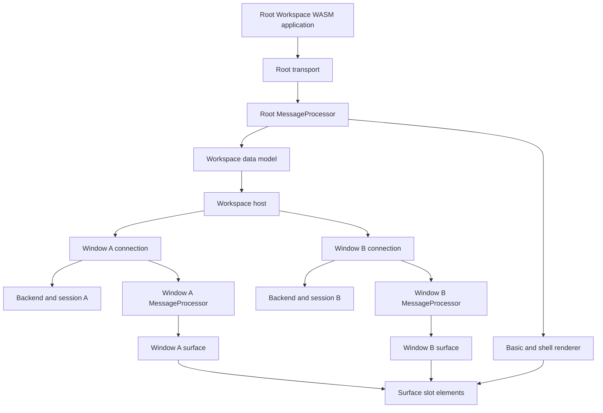

# Spec: SDUI Workspace

Date: 2026-11-26  
Status: proposed

## 1. Summary

Build a browser client where a user can configure application backends, open their A2UI surfaces in windows, and arrange those windows in a workspace.

A root Rust/WASM SDUI application owns the workspace configuration and renders the workspace interface. A TypeScript host owns backend loading, transports, message processors, and surface mounts. Child applications remain independent A2UI applications.

The first proof is an application at `apps/workspace`. It is browser-only and uses dynamically loaded WASM backends. It requires no application server. The existing Todo application becomes the first reusable backend instead of adding a new fixture application.

Remote WebSocket and SSE backends remain part of the target architecture. Their client adapters can connect to user-supplied external endpoints in a later increment. Do not add a repository-owned server to implement or demonstrate the workspace.

## 2. Goals

### 2.1 Target goals

- Let a user add and remove WASM, WebSocket, and SSE backend definitions.
- Let a user open more than one window for a backend.
- Let windows share a runtime session when their backend and session ID match.
- Keep independent state for different runtime sessions.
- Let the root SDUI application control window order and layout.
- Preserve child application state when windows move.
- Support application-owned catalogs without changing A2UI messages.
- Reuse the existing `Application<S>`, `Transport`, `Connection`, and worker lifecycle contracts.

### 2.2 First-proof goals

- Run the root workspace and all child applications in browser WASM.
- Add and remove same-origin WASM backend definitions by JavaScript module URL.
- Open, close, and reorder application windows.
- Select a session ID when opening a window.
- Prove shared-session synchronization and independent-session isolation.
- Load a child WASM package at runtime instead of statically importing it into the host bundle.
- Run the complete proof from a production static build.

## 3. Non-goals

### 3.1 First-proof exclusions

- No native Rust application server.
- No WebSocket or SSE test server.
- No HTTP application API.
- No Vite WebSocket proxy.
- No remote backend required for tests or manual validation.
- No WebSocket or SSE workspace adapter in the first proof.
- No downloaded custom catalogs or renderer code.
- No cross-origin WASM module loading.
- No durable backend, window, or application-state persistence.
- No free-form drag, resize, minimize, or maximize behavior.
- No inter-application messaging.
- No explicit remote session deletion.
- No guarantee that closing the last window terminates a SharedWorker.

A static Vite development or preview process is allowed. It serves application files only.

### 3.2 Permanent constraints

- Do not add custom A2UI envelopes, message fields, compatibility transforms, or parallel protocols.
- Do not put backend routing metadata in A2UI messages.
- Do not merge unrelated child applications into one `MessageProcessor`.
- Do not rewrite child surface IDs.
- Do not make `@sdui/web` depend on Lit or another renderer.
- Do not create a general backend-registry package before a second application needs it.

## 4. Terms

- **Workspace:** the browser application that contains backend definitions and application windows.
- **Backend definition:** user-owned configuration that identifies an application package or remote A2UI endpoint.
- **Backend:** the configured source selected by a backend definition. It is not necessarily a running application.
- **Runtime session:** application state selected by a backend and session ID.
- **Window:** one visual mount of a backend runtime session. Each window has its own transport connection and message processor.
- **Workspace host:** the TypeScript implementation that reconciles root workspace state with active windows.
- **Surface slot:** the shell renderer component that attaches a window's child A2UI surface to the root workspace UI.
- **Backend package:** the JavaScript and WASM assets that satisfy the browser application contract.
- **Management metadata:** backend and window configuration exchanged inside the workspace implementation. It never enters A2UI messages.

## 5. Architecture



### 5.1 Ownership

| Owner                     | Responsibility                                                                                     |
| ------------------------- | -------------------------------------------------------------------------------------------------- |
| Root Rust application     | Backend definitions, window definitions, session selections, ordering, and pure state transitions. |
| Workspace TypeScript host | Dynamic imports, workers, connections, processors, runtime status, and mount lifecycle.            |
| Root renderer             | Workspace controls, backend forms, window chrome, and surface slots.                               |
| Child renderer            | One independent A2UI surface for each child window.                                                |
| `@sdui/web`               | Existing transport and SharedWorker synchronization behavior.                                      |
| Child Rust application    | Its existing state, view, actions, effects, and snapshots.                                         |

The root application must not store connections, workers, processors, DOM references, or other host resources in serializable state.

## 6. Workspace state and identity

### 6.1 Logical state

The first proof uses this logical model. Rust field names follow the existing `A2uiData` and Serde conventions.

```text
WorkspaceState
  backends: BackendDefinition[]
  windows: WindowDefinition[]
  nextBackendId: integer
  nextWindowId: integer

BackendDefinition
  id: string
  name: string
  kind: "wasm"
  moduleUrl: string

WindowDefinition
  id: string
  backendId: string
  sessionId: string
```

Window order is the order of `windows`. Stable numeric counters supply deterministic IDs without adding randomness to pure transitions.

The target model adds backend-specific URL configuration for WebSocket and SSE definitions. Do not place those unused fields in the first-proof model.

### 6.2 Identity rules

- `BackendDefinition.id` identifies saved configuration.
- `WindowDefinition.id` identifies a visual mount.
- A WASM runtime key contains the backend ID, canonical module URL, and session ID.
- A window ID does not identify runtime state.
- A child surface ID does not identify a workspace window.

Two windows share a WASM runtime only when their complete runtime keys match. A module URL change creates a different runtime key. A display-name change does not.

### 6.3 Lifecycle rules

- Adding a backend stores configuration. It does not load the module.
- Opening a window loads the backend if necessary and creates a new connection and processor.
- Closing a window closes only that window's connection and processor.
- Removing a backend first removes all its windows, then removes its definition.
- Reordering a window changes only its visual position.
- Reopening a closed window uses the selected runtime session and receives its snapshot if the worker still exists.
- Closing a window does not promise runtime destruction or state deletion.

## 7. WASM backend package contract

### 7.1 Module interface

The first proof accepts the existing `wasm-bindgen` JavaScript output. A raw `.wasm` URL is not sufficient.

The JavaScript module must supply:

```ts
interface WorkerApplication {
  initial_messages(): string;
  snapshot_messages(): string;
  handle_action(input: string): Promise<string>;
}

interface BackendModule extends WorkerApplication {
  default(): Promise<unknown>;
}
```

The default export initializes the WASM module. The JSON strings contain standard A2UI messages only.

### 7.2 Package location and trust

- First-proof module URLs must resolve to the workspace origin.
- The reusable Todo package is emitted as a static asset and loaded by URL.
- The host must not statically import the Todo module.
- A backend loads only after the user opens a window.
- A malformed or failed module load must report an error in that window without stopping the workspace or other windows.

Cross-origin module support requires a later CORS, CSP, integrity, and trust design.

### 7.3 SharedWorker loading

Use one generic backend-worker entry with Vite's statically analyzable construction.

The SharedWorker name contains canonical management metadata for the runtime key:

```text
backend ID
absolute module URL
session ID
```

The worker reads its name, dynamically imports the module, initializes WASM, and runs the existing worker lifecycle. This metadata stays outside the A2UI message stream.

The worker must register its connection handler before asynchronous loading can allow a port to connect. Snapshots and actions must wait for initialization. Initialization failure must reach the window through transport or worker lifecycle failure, not an A2UI message.

If the current `startApplicationWorker` interface cannot enforce this ordering, extend that reusable interface to accept an asynchronous application loader. Do not copy its action queue, broadcast, and snapshot implementation into the application.

## 8. Rendering and catalogs

### 8.1 Root workspace

The root processor registers:

- The official Basic Catalog.
- An application-owned workspace shell catalog.

The root surface uses Basic as its default catalog. Shell components use their explicit workspace catalog ID through generated builders.

The first proof needs one shell component:

```text
SurfaceSlot
  windowId: DynamicString
```

`SurfaceSlot` has no child component and no custom action. Basic Catalog forms and buttons own all first-proof workspace actions.

The Lit implementation attaches the child surface for `windowId`. Slot attach and detach operations must be idempotent. A slot disconnect caused by DOM movement must not close a backend connection.

### 8.2 Child windows

- Each window has one fresh `MessageProcessor`.
- Each processor registers only the Basic Catalog in the first proof.
- Each backend supplies exactly one surface in the first proof.
- The host mounts the first created surface without requiring a configured surface ID.
- Deleting that surface clears its slot.
- Two backends may both use surface ID `main` because their processors are separate.

Register all required catalogs before connecting the transport. Do not depend on adding a catalog after the first `createSurface` arrives.

### 8.3 Why processors stay separate

One processor per window provides surface-ID isolation, direct outbound routing, independent catalog registration, independent recovery, and independent failure handling. It also preserves the existing fresh-processor snapshot rule.

## 9. Workspace host reconciliation

The host subscribes to the root surface's backend and window data. After each root update, it compares desired state with active mounts.

For each new window:

1. Resolve its backend definition.
2. Create the backend transport from the backend and session configuration.
3. Create a processor and register surface listeners.
4. Connect only after listeners and catalogs are ready.
5. Register the resulting mount under the stable window ID.
6. Attach the mount when its surface slot appears.

For each removed window:

1. Remove its slot attachment.
2. Close its connection.
3. Dispose its processor.
4. Delete its active mount.

For an unchanged window ID:

- Preserve its connection, processor, worker, and child state.
- Update only slot placement when order changes.

Connection status and errors are host-owned in the first proof. `SurfaceSlot` may display loading, offline, and error states. The root Rust application does not claim to know actual transport status.

Reconciliation must be idempotent so repeated root snapshots or equivalent data updates do not duplicate connections.

## 10. First-proof application

### 10.1 Location and contents

Extract the reusable Todo backend and create a private application named `@sdui/workspace`:

```text
apps/
  todo/                 Reusable Todo Rust/WASM backend package; no server
  workspace/            Browser-only workspace application
    rust/               Root workspace WASM crate
    src/                TypeScript host, workers, and Lit renderer adapter
    index.html
    package.json
    vite.config.ts
  browser-example/      Existing browser and native integration examples
```

The Todo package owns the existing Todo state, actions, views, Basic Catalog generation, and WASM adapter. It has no server or native binaries. The browser example consumes the same Rust application for its existing native and transport demonstrations.

The workspace builds the Todo package as an independently addressable static backend. It must not import generated build output from another application's directory.

The root application may reuse the existing static worker pattern. The generic backend worker imports the Todo module at runtime.

### 10.2 Build requirements

- Development and production commands build the root workspace and reusable Todo WASM packages.
- The Todo JavaScript and WASM files are copied as static assets.
- Vite does not inline the Todo package into the host or backend-worker bundle.
- Production output contains the root worker and WASM assets.
- Production output also contains separately addressable Todo JavaScript and WASM assets.
- Development and preview commands start no application server or transport proxy.

### 10.3 User operations

The root SDUI interface provides:

- A backend name input.
- A WASM JavaScript module URL input.
- Add and remove backend actions.
- A session ID input for opening a window.
- Open and close window actions.
- Move earlier and move later actions.

The provided default module URL points to the Todo package. Todo windows provide add, edit, complete, filter, and delete actions so state and synchronization are visible. An unsubmitted draft also proves that window movement preserves renderer-local state.

## 11. Acceptance criteria

The first proof is complete when all these scenarios pass from a production build:

1. **Add backend:** the user adds the Todo package by module URL. Its definition appears, but no backend worker starts.
2. **Open:** the user opens a Todo window. The worker loads and the Todo surface appears in its surface slot.
3. **Shared session:** two windows with the same backend and session ID show the same todos. An add or complete action in either window updates both.
4. **Independent session:** a window with a different session ID keeps independent Todo state.
5. **Surface isolation:** all Todo packages can use surface ID `main` without conflicts.
6. **Move:** moving a window changes only its visual order. Todos, unsubmitted drafts, and active connections remain intact.
7. **Close:** closing one of two shared-session windows leaves the other window operational.
8. **Snapshot:** reopening the same backend and session restores the current todos when its worker remains alive.
9. **Remove backend:** removing a definition closes all its windows and removes their slots.
10. **Load failure:** an invalid module URL produces a contained window error. Existing windows and root controls continue to work.
11. **No server:** the proof runs without a native server, WebSocket server, SSE server, application API, or transport proxy.
12. **Production assets:** the built Todo package is loaded from its own static URL and is not statically imported by the host.

## 12. Tests and validation

Keep tests focused on workspace behavior.

### Rust

- Add, remove, open, close, and reorder transitions.
- Stable IDs and stable window action context.
- Backend removal closes all associated windows in desired state.
- Session IDs and module URLs are validated.
- Root state serialization and emitted A2UI messages remain standard.

### TypeScript

- Runtime-key construction and worker-name parsing.
- Invalid worker metadata and module-load failures.
- Connections wait for asynchronous initialization.
- Reconciliation creates and disposes each window once.
- Reordering does not reconnect or dispose.
- Slot detach and reattach do not close a connection.
- A failed window does not affect other windows.
- Existing Todo, transport, worker, and browser-example tests continue to pass.

Use local fakes or `LocalStreamTransport` for deterministic host tests. Do not add a server for tests.

### Production browser validation

Run the applicable repository gates sequentially, then use `pnpm run preview` and Playwriter for the workspace application.

- Inspect emitted root worker, root WASM, Todo JavaScript, and Todo WASM assets.
- Execute the shared-session, independent-session, move, close, reopen, and remove scenarios.
- Use role and label selectors.
- Confirm that no application server process is required.
- Stop the preview process after validation.

## 13. Security and recovery

- Treat backend JavaScript as executable code, even when it runs in a worker.
- Show the resolved module origin before the user opens a backend.
- Reject non-same-origin module URLs in the first proof.
- Keep custom renderer code outside the first proof.
- Treat all remote A2UI content as untrusted when URL backends are added.
- Never replay outbound actions automatically after reconnect.
- Use a fresh processor for every new connection or authoritative snapshot.
- Do not interpret a worker or session ID as authentication.

## 14. Later increments

Implement these as separate, tested increments:

1. **WebSocket backends:** user-supplied external endpoints, explicit URL session routing, authentication, CORS, CSP, and mixed-content handling.
2. **SSE backends:** separate event and send URLs plus ordered POST behavior from the existing adapter.
3. **Backend editing:** runtime-key migration without accidental reuse of old state.
4. **Custom catalogs:** package-declared renderer implementations loaded before surface creation, with an explicit trust policy.
5. **Cross-origin WASM:** CORS, CSP, integrity, and user-consent rules.
6. **Persistence:** application-owned storage for workspace configuration and runtime state.
7. **Window customization:** drag, resize, minimize, and layout modes. Commit one root action after a pointer interaction instead of sending every pointer movement.
8. **Runtime status in SDUI:** a defined host-to-root event path if host-observed status must enter Rust state.
9. **Explicit runtime termination:** a management operation outside A2UI if closing the last window must destroy state.

Remote backend support remains client-only. It must not introduce a repository-owned application server.

## 15. Resolved first-proof decisions

- The application name is `workspace`, under `apps/workspace`.
- The existing Todo application is extracted into a reusable, server-free backend under `apps/todo`.
- The browser example and workspace consume the same Todo Rust application without duplicating it.
- The root interface is a Rust/WASM SDUI application.
- The proof loads only same-origin `wasm-bindgen` backend packages.
- Child applications use the Basic Catalog.
- The root adds one custom `SurfaceSlot` component through a shell catalog.
- Each window owns a separate processor and connection.
- Window movement never recreates a runtime.
- Backend removal cascades to its windows.
- Runtime destruction and durable persistence are excluded.
- No application server is built or required.
