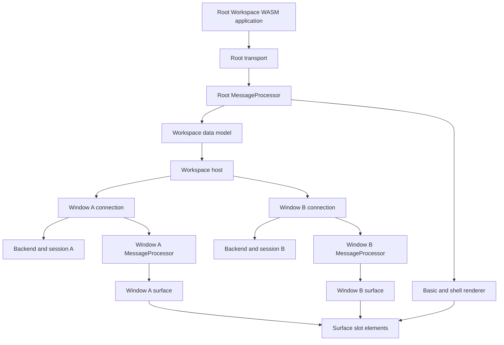

# Spec: SDUI Workspace

Date: 2026-11-27
Status: proposed

## 1. Summary

Build a browser client where a user can install applications, open their A2UI surfaces in windows, and arrange those windows in a workspace. A user can also use an LLM to generate a new application or change the interface of an installed application.

Standard A2UI is the editable interface source. The LLM maps application data and actions to A2UI components and bindings. Do not add a second interface-description language.

A root Rust/WASM SDUI application owns the workspace configuration and renders the workspace interface. A TypeScript host owns backend loading, transports, message processors, surface mounts, interface projection, application storage, and LLM provider clients. Child applications remain independent A2UI applications.

The first proof is a workspace shell at `apps/workspace`. It is browser-only and uses dynamically loaded WASM backends. It requires no application server. The existing Todo application becomes the first reusable backend instead of adding a new fixture application. Tickets 01 through 06 cover this shell only.

Later increments add editable interface revisions, a persistent application library, and LLM authoring through WebLLM, Ollama, or a direct browser LLM API. Generated applications execute as JavaScript modules that satisfy the existing worker application contract. They require no Rust compilation or application server.

Remote WebSocket and SSE backends remain part of the target architecture. Their client adapters can connect to user-supplied external endpoints in a later increment. Do not add a repository-owned server to implement or demonstrate the workspace. User-supplied Ollama and LLM API endpoints are provider services, not workspace application servers.

## 2. Goals

### 2.1 Target goals

- Let a user install, reopen, and remove persistent WASM and generated JavaScript applications.
- Let a user add and remove WASM, WebSocket, and SSE backend definitions.
- Let a user generate a new browser application through an LLM without a compiler or application server.
- Let a user preview, apply, and roll back LLM-generated A2UI interface revisions.
- Preserve the backend runtime session during a compatible interface-only revision.
- Support WebLLM in the browser, Ollama on a local or server machine, and direct browser LLM APIs through one provider interface.
- Keep provider credentials and generated executable source outside A2UI state.
- Let a user open more than one window for a backend.
- Let windows share a runtime session when their backend and session ID match.
- Keep independent state for different runtime sessions.
- Let the root SDUI application control window order and layout.
- Preserve child application state when windows move.
- Support application-owned catalogs without changing A2UI messages.
- Reuse the existing `Application<S>`, `Transport`, `Connection`, and worker lifecycle contracts.

### 2.2 Workspace shell proof goals

- Run the root workspace and all child applications in browser WASM.
- Add and remove same-origin WASM backend definitions by JavaScript module URL.
- Open, close, and reorder application windows.
- Select a session ID when opening a window.
- Prove shared-session synchronization and independent-session isolation.
- Load a child WASM package at runtime instead of statically importing it into the host bundle.
- Run the complete proof from a production static build.

## 3. Non-goals

### 3.1 Workspace shell exclusions

- No native Rust application server.
- No WebSocket or SSE test server.
- No HTTP application API.
- No Vite WebSocket proxy.
- No remote backend required for tests or manual validation.
- No WebSocket or SSE workspace adapter in the first proof.
- No downloaded custom catalogs or renderer code.
- No cross-origin WASM module loading.
- No durable backend, window, or application-state persistence.
- No persistent application library.
- No editable interface revisions or interface projection.
- No LLM provider, generated application module, or model-written interface.
- No free-form drag, resize, minimize, or maximize behavior.
- No inter-application messaging.
- No explicit remote session deletion.
- No guarantee that closing the last window terminates a SharedWorker.

A static Vite development or preview process is allowed. It serves application files only.

### 3.2 Permanent constraints

- Do not add custom A2UI envelopes, message fields, compatibility transforms, or parallel protocols.
- Do not put backend routing metadata in A2UI messages.
- Do not merge unrelated child applications into one `MessageProcessor`.
- Do not rewrite child surface IDs.
- Do not make `@sdui/web` depend on Lit or another renderer.
- Do not create a general backend-registry package before a second application needs it.
- Do not add a second interface-description language for LLM authoring. Editable interfaces use standard A2UI catalogs, components, bindings, and actions.
- Do not put interface revisions, provider configuration, or provider credentials into child A2UI messages.
- Do not include an interface revision in the backend runtime key.
- Do not send provider credentials to application workers or persist them in the application library.

## 4. Terms

- **Workspace:** the browser application that contains installed applications, backend definitions, and application windows.
- **Application:** the user-facing identity of a backend definition and its interface revisions. Its stable identity is the backend definition ID.
- **Backend definition:** user-owned configuration that identifies an application package or remote A2UI endpoint.
- **Backend:** the configured source selected by a backend definition. It is not necessarily a running application.
- **Runtime session:** application state selected by a backend and session ID.
- **Window:** one visual mount of a backend runtime session. Each window has its own transport connection and message processor.
- **Workspace host:** the TypeScript implementation that reconciles root workspace state with active windows.
- **Surface slot:** the shell renderer component that attaches a window's child A2UI surface to the root workspace UI.
- **Backend package:** the JavaScript and optional WASM assets that satisfy the browser application contract.
- **Editable interface:** a standard A2UI surface definition whose catalog and components can supply the view for backend data and actions.
- **Interface revision:** an immutable version of an editable interface selected for an application. It is not a runtime session.
- **Interface projection:** a host mount that combines the selected interface revision with the backend surface ID, current data model, and action transport.
- **Application library:** the target host-owned store for installed application definitions, generated module source, and interface revisions.
- **LLM provider:** a host-owned adapter that generates text or structured draft content from an authoring request.
- **Authoring draft:** unapplied model output containing a generated application or interface revision. Validation and preview do not install or apply it.
- **Management metadata:** backend, window, interface, and provider configuration exchanged inside the workspace implementation. It never enters child A2UI messages.

## 5. Architecture

The workspace shell uses this message flow:



Target authoring adds host-side application-library and provider modules. A provider creates an authoring draft; validation and isolated preview precede storage or selection. The application library supplies the selected revision to the same window mount path shown above. Model output never bypasses the host and enters a child processor directly.

### 5.1 Ownership

| Owner                     | Responsibility                                                                                                      |
| ------------------------- | ------------------------------------------------------------------------------------------------------------------- |
| Root Rust application     | Backend definitions, window definitions, session selections, selected revision IDs, ordering, and pure transitions. |
| Workspace TypeScript host | Dynamic imports, workers, connections, processors, interface projection, runtime status, and mount lifecycle.       |
| Application library       | Host-owned persistent definitions, generated module source, and immutable interface revisions.                      |
| LLM provider adapters     | Host-owned model requests, cancellation, provider errors, and provider-specific configuration.                      |
| Root renderer             | Workspace controls, application and backend forms, window chrome, and surface slots.                                |
| Child renderer            | One independent A2UI surface for each child window.                                                                 |
| `@sdui/web`               | Existing transport and SharedWorker synchronization behavior.                                                       |
| Child application         | Its state, actions, effects, current data snapshots, and compiled fallback view.                                    |

The root application must not store connections, workers, processors, DOM references, model streams, provider credentials, generated executable source, or other host resources in serializable state. The host owns interface documents and executable source; root state contains only their stable IDs and non-secret configuration.

## 6. Workspace state and identity

### 6.1 Logical state

The first proof uses this logical model. Rust field names follow the existing `A2uiData` and Serde conventions.

```text
WorkspaceState
  backends: BackendDefinition[]
  windows: WindowDefinition[]
  nextBackendId: integer
  nextWindowId: integer

BackendDefinition
  id: string
  name: string
  kind: "wasm"
  moduleUrl: string

WindowDefinition
  id: string
  backendId: string
  sessionId: string
```

Window order is the order of `windows`. Stable numeric counters supply deterministic IDs without adding randomness to pure transitions.

The target model adds backend-specific URL configuration for WebSocket and SSE definitions, a generated JavaScript backend kind, and an optional selected interface revision ID for each backend definition. Generated source remains in the host library rather than root Rust state. Do not place unused target fields in the first-proof model.

The host-owned application library stores interface documents and generated module source. An interface revision has this logical content:

```text
InterfaceRevision
  id: string
  backendId: string
  surfaceId: string
  catalogId: string
  components: standard A2UI Component[]
```

The revision contains no current application data. Its `surfaceId` prevents accidental projection onto another surface. The host combines its catalog and components with the backend's current `dataModel` to create a standard A2UI `createSurface` input for the child processor.

### 6.2 Identity rules

- `BackendDefinition.id` identifies saved configuration.
- `WindowDefinition.id` identifies a visual mount.
- A WASM runtime key contains the backend ID, canonical module URL, and session ID.
- A window ID does not identify runtime state.
- A child surface ID does not identify a workspace window.
- `InterfaceRevision.id` identifies immutable interface content. It does not identify runtime state.
- An interface revision belongs to one backend definition and is shared by that definition's windows and sessions.

Two windows share a WASM runtime only when their complete runtime keys match. A module URL change creates a different runtime key. A display-name or interface-revision change does not.

### 6.3 Lifecycle rules

- Adding a backend stores configuration. It does not load the module.
- Opening a window loads the backend if necessary and creates a new connection and processor.
- Closing a window closes only that window's connection and processor.
- Removing a backend first removes all its windows, then removes its definition.
- Reordering a window changes only its visual position.
- Reopening a closed window uses the selected runtime session and receives its snapshot if the worker still exists.
- Closing a window does not promise runtime destruction or state deletion.

### 6.4 Target interface lifecycle

- An authoring draft does not change the selected interface or installed application.
- Preview uses an ephemeral preview mount with an explicit draft-revision override and a separate preview session ID and runtime key. It does not change the backend definition's selected revision.
- Preview actions cannot modify the user's live session. Closing preview disposes its mount, connection, processor, and ephemeral configuration; SharedWorker destruction follows existing lifecycle rules.
- Applying an interface revision selects it for every ordinary window of that backend definition.
- Applying or rolling back a revision may create fresh window processors and connections. It must keep the same backend runtime key, worker, and session state.
- Interface application must not replay outbound actions. Renderer-local drafts may reset; backend application state must survive.
- Closing and reopening a window projects the selected revision over the current backend snapshot.
- A failed validation or preview leaves the live interface unchanged.
- A UI-only revision cannot add a backend action, change an action payload, or introduce authoritative application state. Those changes require an editable backend module revision.

### 6.5 Target application-library recovery

- The host loads and validates durable workspace configuration before root workspace initialization and reconciliation.
- An application-owned management bootstrap supplies the restored configuration to the root worker before its first authoritative root snapshot. This bootstrap is outside A2UI and does not replay workspace actions.
- The root application initializes its backend definitions, windows, selections, and ID counters from that configuration. Host reconciliation waits for the restored root snapshot so default initial state cannot create or remove mounts.
- Invalid durable data causes a contained recovery error and no partial reconciliation. A user can reset the damaged library.
- This root initialization path does not change the child `WorkerApplication` contract or add custom A2UI messages.

## 7. Backend package contract

### 7.1 Module interface

The first proof accepts the existing `wasm-bindgen` JavaScript output. A raw `.wasm` URL is not sufficient.

The JavaScript module must supply:

```ts
interface WorkerApplication {
  initial_messages(): string;
  snapshot_messages(): string;
  handle_action(input: string): Promise<string>;
}

interface BackendModule extends WorkerApplication {
  default(): Promise<unknown>;
}
```

The default export initializes the module, including WASM when present. The JSON strings contain standard A2UI messages only.

### 7.2 Package location and trust

- First-proof module URLs must resolve to the workspace origin.
- The reusable Todo package is emitted as a static asset and loaded by URL.
- The host must not statically import the Todo module.
- A backend loads only after the user opens a window.
- A malformed or failed module load must report an error in that window without stopping the workspace or other windows.

Cross-origin module support requires a later CORS, CSP, integrity, and trust design.

### 7.3 SharedWorker loading

Use one generic backend-worker entry with Vite's statically analyzable construction.

The SharedWorker name contains canonical management metadata for the runtime key:

```text
backend ID
absolute module URL
session ID
```

The worker reads its name, dynamically imports the module, runs its initializer, and runs the existing worker lifecycle. This metadata stays outside the A2UI message stream.

The worker must register its connection handler before asynchronous loading can allow a port to connect. Snapshots and actions must wait for initialization. Initialization failure must reach the window through transport or worker lifecycle failure, not an A2UI message.

If the current `startApplicationWorker` interface cannot enforce this ordering, extend that reusable interface to accept an asynchronous application loader. Do not copy its action queue, broadcast, and snapshot implementation into the application.

### 7.4 Generated JavaScript application modules

The target application generator emits an ordinary JavaScript module that satisfies the same `BackendModule` and `WorkerApplication` contract. Its default export can be a no-op initializer when no WASM is required. The generic backend worker and existing synchronization implementation are reused.

Generated source requires explicit user consent before execution. It runs in an application worker, never in the root workspace realm. UI-only edits change the selected interface revision and do not regenerate the module. A behavior change requires a new module revision and a new preview and consent decision.

Generated applications that expose dynamic lists for interface editing must use standard A2UI child templates with stable template component IDs and relative item bindings in both the fallback view and editable revisions. Positional expanded row IDs are not a stable editing contract.

Generated module source is stored by the application library. Blob URLs or other transient module URLs do not supply application identity and are not included in durable configuration. No compiler, repository-owned server, custom renderer module, or custom A2UI message is required.

## 8. Rendering and catalogs

### 8.1 Root workspace

The root processor registers:

- The official Basic Catalog.
- An application-owned workspace shell catalog.

The root surface uses Basic as its default catalog. Shell components use their explicit workspace catalog ID through generated builders.

The first proof needs one shell component:

```text
SurfaceSlot
  windowId: DynamicString
```

`SurfaceSlot` has no child component and no custom action. Basic Catalog forms and buttons own all first-proof workspace actions.

The Lit implementation attaches the child surface for `windowId`. Slot attach and detach operations must be idempotent. A slot disconnect caused by DOM movement must not close a backend connection.

### 8.2 Child windows

- Each window has one fresh `MessageProcessor`.
- Each processor registers only the Basic Catalog in the first proof.
- Each backend supplies exactly one surface in the first proof.
- The host mounts the first created surface without requiring a configured surface ID.
- Deleting that surface clears its slot.
- Two backends may both use surface ID `main` because their processors are separate.

Register all required catalogs before connecting the transport. Do not depend on adding a catalog after the first `createSurface` arrives.

### 8.3 Why processors stay separate

One processor per window provides surface-ID isolation, direct outbound routing, independent catalog registration, independent recovery, and independent failure handling. It also preserves the existing fresh-processor snapshot rule.

### 8.4 Target editable interface projection

Without a selected interface revision, the backend-authored view behaves as in the shell proof. The first editable-interface increment supports one child surface per backend.

With a selected revision, the host creates the child processor input as follows:

1. Receive the authoritative backend `createSurface` after connection.
2. Validate that the revision has the same surface ID and uses a registered catalog.
3. Use the backend surface ID and current `dataModel` with the revision's `catalogId` and standard A2UI `components`.
4. Process that standard `createSurface` with a fresh child processor.
5. Apply later backend `updateDataModel` messages normally. While the revision is selected, backend `createSurface` and `updateComponents` refresh the fallback view and action contract but do not replace the selected components.
6. Preserve standard `deleteSurface` behavior. Route outbound actions to the unchanged backend connection without adding management metadata.

Revalidate the exposed revision contract against later fallback component updates. If a required action or binding disappears or changes, fail closed: block affected projected actions, show a host-owned incompatibility error, and offer rollback. Do not send an action to a different positional component or silently restore the fallback view.

This is interface selection, not a protocol conversion. Every processor input and outbound action remains standard A2UI. The host copies validated A2UI data through official SDK types and does not invent or rewrite surface IDs, component IDs, data paths, event names, or action context. Hand-written application views continue to use generated catalog builders and typed state bindings.

A UI-only revision must preserve the backend contract for every action it exposes: source component ID, event name, context, and bound state paths. Projection does not make an arbitrary compiled view editable. Backends with unstable positional component IDs can use their fallback view, but those unstable components and actions are excluded from interface revisions.

Dynamic list editing requires standard A2UI child templates with stable template component IDs and relative item bindings in the backend fallback view and selected revision. The first Todo fixture revision uses stable non-list controls only; it does not project Todo's positional row components or row actions.

Validation builds a conservative whitelist from current fallback action definitions, fallback component bindings, stable component IDs, current data paths, and an app-supplied schema when available. Relative template bindings are valid only in their declared list-path scope. This permits fallback-defined item bindings when a collection is empty. Unknown action contracts and paths are rejected when neither the fallback interface nor a schema defines them. The current snapshot is not a complete state schema because empty collections and optional fields can be absent; preview success does not prove that an absent path or conditional action is valid.

## 9. Workspace host reconciliation

The host subscribes to the root surface's backend and window data. After each root update, it compares desired state with active mounts.

For each new window:

1. Resolve its backend definition.
2. Create the backend transport from the backend and session configuration.
3. Create a processor and register surface listeners.
4. Connect only after listeners and catalogs are ready.
5. Register the resulting mount under the stable window ID.
6. Attach the mount when its surface slot appears.

For each removed window:

1. Remove its slot attachment.
2. Close its connection.
3. Dispose its processor.
4. Delete its active mount.

For an unchanged window ID:

- Preserve its connection, processor, worker, and child state.
- Update only slot placement when order changes.

Connection status and errors are host-owned in the first proof. `SurfaceSlot` may display loading, offline, and error states. The root Rust application does not claim to know actual transport status.

Reconciliation must be idempotent so repeated root snapshots or equivalent data updates do not duplicate connections.

A selected interface revision change is not a reorder. The target host may reconnect affected windows to create fresh processors, but it must retain their runtime keys and SharedWorker sessions. Reordering still preserves the connection, processor, worker, and renderer-local state.

## 10. Workspace shell application

### 10.1 Location and contents

Extract the reusable Todo backend and create a private application named `@sdui/workspace`:

```text
apps/
  todo/                 Reusable Todo Rust/WASM backend package; no server
  workspace/            Browser-only workspace application
    rust/               Root workspace WASM crate
    src/                TypeScript host, workers, and Lit renderer adapter
    index.html
    package.json
    vite.config.ts
  browser-example/      Existing browser and native integration examples
```

The Todo package owns the existing Todo state, actions, views, Basic Catalog generation, and WASM adapter. It has no server or native binaries. The browser example consumes the same Rust application for its existing native and transport demonstrations.

The workspace builds the Todo package as an independently addressable static backend. It must not import generated build output from another application's directory.

The root application may reuse the existing static worker pattern. The generic backend worker imports the Todo module at runtime.

### 10.2 Build requirements

- Development and production commands build the root workspace and reusable Todo WASM packages.
- The Todo JavaScript and WASM files are copied as static assets.
- Vite does not inline the Todo package into the host or backend-worker bundle.
- Production output contains the root worker and WASM assets.
- Production output also contains separately addressable Todo JavaScript and WASM assets.
- Development and preview commands start no application server or transport proxy.

### 10.3 User operations

The root SDUI interface provides:

- A backend name input.
- A WASM JavaScript module URL input.
- Add and remove backend actions.
- A session ID input for opening a window.
- Open and close window actions.
- Move earlier and move later actions.

The provided default module URL points to the Todo package. Todo windows provide add, edit, complete, filter, and delete actions so state and synchronization are visible. An unsubmitted draft also proves that window movement preserves renderer-local state.

## 11. Acceptance criteria

### 11.1 Workspace shell proof

The workspace shell proof is complete when all these scenarios pass from a production build:

1. **Add backend:** the user adds the Todo package by module URL. Its definition appears, but no backend worker starts.
2. **Open:** the user opens a Todo window. The worker loads and the Todo surface appears in its surface slot.
3. **Shared session:** two windows with the same backend and session ID show the same todos. An add or complete action in either window updates both.
4. **Independent session:** a window with a different session ID keeps independent Todo state.
5. **Surface isolation:** all Todo packages can use surface ID `main` without conflicts.
6. **Move:** moving a window changes only its visual order. Todos, unsubmitted drafts, and active connections remain intact.
7. **Close:** closing one of two shared-session windows leaves the other window operational.
8. **Snapshot:** reopening the same backend and session restores the current todos when its worker remains alive.
9. **Remove backend:** removing a definition closes all its windows and removes their slots.
10. **Load failure:** an invalid module URL produces a contained window error. Existing windows and root controls continue to work.
11. **No server:** the proof runs without a native server, WebSocket server, SSE server, application API, or transport proxy.
12. **Production assets:** the built Todo package is loaded from its own static URL and is not statically imported by the host.

### 11.2 Application authoring proof

The target authoring path is complete when these scenarios pass from a production static build:

1. **Fixture revision:** a fixture A2UI revision changes stable non-list Todo layout or labels while its exposed actions, current todos, shared-session data synchronization, close/reopen, and rollback continue to work.
2. **Runtime preservation:** applying or rolling back a UI-only revision keeps the backend runtime key and worker session. No outbound action is replayed.
3. **Contained validation:** invalid components, catalogs, surface IDs, state paths, or action contracts do not change the live application.
4. **Persistent library:** an installed application and its selected interface revision survive a browser reload. Uninstall closes its windows and removes its library records.
5. **Generate application:** an LLM draft creates a JavaScript worker application and initial A2UI interface. Preview does not install it; explicit apply installs it and allows it to open and handle actions.
6. **Edit interface:** an LLM prompt changes an existing interface through the same fixture-proven projection path. Compatible backend data survives apply and rollback.
7. **Contained authoring failure:** malformed model output, cancellation, and provider failures leave installed applications and live interfaces unchanged.
8. **Provider parity:** WebLLM, Ollama, and the direct browser API can supply drafts to the same generation and editing workflows. Real-provider validation uses available compatible hardware or user-supplied endpoints.
9. **Credential isolation:** provider credentials never appear in A2UI messages, root Rust state, durable application-library data, logs, or generated application workers.
10. **No application server:** generation, installation, interface editing, and application execution require no Rust compilation, repository-owned application server, or transport proxy.

## 12. Tests and validation

Keep tests focused on workspace behavior.

### Rust

- Add, remove, open, close, and reorder transitions.
- Stable IDs and stable window action context.
- Backend removal closes all associated windows in desired state.
- Session IDs and module URLs are validated.
- Root state serialization and emitted A2UI messages remain standard.

### TypeScript

- Runtime-key construction and worker-name parsing.
- Invalid worker metadata and module-load failures.
- Connections wait for asynchronous initialization.
- Reconciliation creates and disposes each window once.
- Reordering does not reconnect or dispose.
- Slot detach and reattach do not close a connection.
- A failed window does not affect other windows.
- Existing Todo, transport, worker, and browser-example tests continue to pass.

Use local fakes or `LocalStreamTransport` for deterministic host tests. Do not add a server for shell tests.

### Application authoring and providers

- Project a fixture interface over initial snapshots and later data updates without applying backend component updates.
- Preserve surface IDs, stable action source IDs, event names, context, and runtime keys.
- Reject invalid interface revisions, unknown contract data, and unstable positional row overrides without changing the selected live revision.
- Preview through an ephemeral override and runtime key, clean up preview resources, and roll back without replaying actions.
- Restore root state through management bootstrap before the first root snapshot and reconciliation; test invalid stored data and uninstall cleanup.
- Persist and restore application definitions, generated source, and interface revisions.
- Use a deterministic fake LLM provider for generation and editing workflow tests. Do not depend on model quality or a network in automated tests.
- Test provider cancellation, timeouts, malformed responses, and provider-specific connection failures through the common provider interface.
- Verify that generated application workers cannot access provider credentials.

### Production browser validation

Run the applicable repository gates sequentially, then use `pnpm run preview` and Playwriter for the workspace application.

- Inspect emitted root worker, root WASM, Todo JavaScript, and Todo WASM assets.
- Execute the shared-session, independent-session, move, close, reopen, and remove scenarios.
- Use role and label selectors.
- Confirm that no application server process is required.
- Stop the preview process after validation.

For the target authoring proof, also validate fixture revision apply and rollback, library reload and uninstall, generated application preview and installation, and LLM interface editing. Exercise each real provider when its required WebGPU hardware or user-supplied endpoint is available. Never commit provider credentials or record them in validation artifacts.

## 13. Security and recovery

- Treat backend JavaScript as executable code, even when it runs in a worker. A worker isolates the DOM; it is not a security sandbox for origin network or storage access.
- Treat model-written JavaScript and A2UI as untrusted content. Require preview and explicit user consent before installation or application.
- Never execute model output directly in the root workspace realm.
- Show the resolved module origin before the user opens a backend.
- Reject non-same-origin module URLs in the first proof.
- Keep custom renderer code outside the first proof.
- Treat all remote A2UI content as untrusted when URL backends are added.
- Never replay outbound actions automatically after reconnect.
- Use a fresh processor for every new connection or authoritative snapshot.
- Do not interpret a worker or session ID as authentication.
- Keep LLM provider clients and credentials in the host. Do not persist credentials by default or place them in root Rust state, A2UI messages, logs, generated source, or application workers.
- Direct browser provider access requires provider-compatible CORS and mixed-content handling. Warn the user that a direct browser API credential is available to that browser session.
- Do not apply an authoring draft automatically. Validation and isolated preview precede every install, module revision, or interface apply. Rollback reuses a previously validated revision through the same application path.

## 14. Later increments

Implement these as separate, tested increments:

- **Editable interface revisions:** fixture-driven projection, conservative stable-contract validation, ephemeral isolated preview, apply, close/reopen, and rollback without an LLM.

2. **Persistent application library:** installed definitions, generated JavaScript source, selected interface revisions, reload, and uninstall. Runtime-state persistence remains application-owned.
3. **LLM provider core:** one asynchronous provider interface, non-secret selection, host-owned credentials, cancellation, and a deterministic fake provider.
4. **Generated applications:** model-written JavaScript worker modules and initial A2UI interfaces through draft, validation, preview, consent, and installation.
5. **LLM interface editing:** current A2UI plus current data and catalog context, followed by the fixture-proven validation, preview, apply, and rollback path.
6. **Ollama provider:** user-supplied local or server URL, model selection, direct browser HTTP, cancellation, CORS, and mixed-content handling.
7. **WebLLM provider:** a separate provider worker, WebGPU capability detection, model download and cache status, cancellation, and local execution.
8. **Direct browser LLM API:** a user-supplied OpenAI-compatible endpoint and model, host-session credentials, direct browser HTTP, cancellation, CORS, and mixed-content handling.
9. **WebSocket backends:** user-supplied external endpoints, explicit URL session routing, authentication, CORS, CSP, and mixed-content handling.
10. **SSE backends:** separate event and send URLs plus ordered POST behavior from the existing adapter.
11. **Backend editing:** runtime-key migration without accidental reuse of old state. Interface-only editing must not use this path.
12. **Custom catalogs:** package-declared renderer implementations loaded before surface creation, with an explicit trust policy.
13. **Cross-origin WASM:** CORS, CSP, integrity, and user-consent rules.
14. **Window customization:** drag, resize, minimize, and layout modes. Commit one root action after a pointer interaction instead of sending every pointer movement.
15. **Runtime status in SDUI:** a defined host-to-root event path if host-observed status must enter Rust state.
16. **Explicit runtime termination:** a management operation outside A2UI if closing the last window must destroy state.

Remote backend support remains client-only. It must not introduce a repository-owned application server.

## 15. Resolved decisions

### 15.1 Workspace shell

- The application name is `workspace`, under `apps/workspace`.
- The existing Todo application is extracted into a reusable, server-free backend under `apps/todo`.
- The browser example and workspace consume the same Todo Rust application without duplicating it.
- The root interface is a Rust/WASM SDUI application.
- The proof loads only same-origin `wasm-bindgen` backend packages.
- Child applications use the Basic Catalog.
- The root adds one custom `SurfaceSlot` component through a shell catalog.
- Each window owns a separate processor and connection.
- Window movement never recreates a runtime.
- Backend removal cascades to its windows.
- Runtime destruction and durable persistence are excluded.
- No application server is built or required.

### 15.2 Target application authoring

- Standard A2UI is the editable interface source and the LLM's state-to-view mapping format. No second interface-description language is added.
- The backend definition ID is the stable application identity. Interface revisions and transient module URLs do not change it.
- Interface revisions belong to backend definitions, not runtime sessions.
- The host projects a selected revision over backend data and routes unchanged standard actions to the backend.
- UI-only edits preserve a stable backend action and state contract. Unstable positional component IDs are not editable; dynamic lists require stable A2UI child-template IDs and relative bindings. Behavior changes require an editable backend module revision.
- Preview uses an ephemeral mount and runtime key with a draft override; it never changes the live backend's selected revision.
- Durable workspace state restores through a pre-snapshot management bootstrap, not A2UI action replay.
- Applying or rolling back an interface may reconnect a window processor, but it does not change the runtime key or intentionally destroy session state.
- Generated applications are JavaScript `WorkerApplication` modules. They reuse the generic backend worker and need no compiler or application server.
- One provider interface supports WebLLM, Ollama, and direct browser LLM API adapters. Automated workflow tests use a deterministic fake provider.
- Provider credentials are host-session secrets, not workspace or A2UI data.
