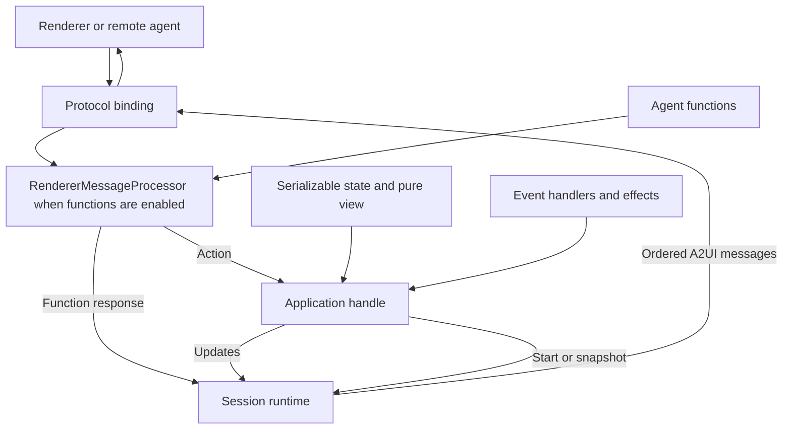

# Proposal: A2UI bindings for SDUI applications

Date: 2026-11-25  
Status: proposed; no implementation approved or included

## 1. Summary

Keep the current SDUI authoring model unchanged. Add protocol bindings outside `Application<S>` so the same application can serve existing browser transports today and external A2UI ecosystems when required.

Proceed in this order:

1. **A2A:** implement a small native Rust vertical slice with complete A2UI v1.0 message coverage.
2. **MCP:** later add a scoped native resource/tool adapter for a concrete MCP host.
3. **AG-UI:** defer unless a concrete AG-UI target cannot use the official integration.

Do not start a three-protocol project. Do not create a universal binding abstraction. A2A, MCP, and AG-UI have different lifecycle and metadata contracts.

## 2. Goals

- Preserve `Application::start`, `snapshot`, `handle`, and `close` as the application interface.
- Preserve standard A2UI v1.0 messages and their order.
- Support the complete A2UI message union where the binding defines it.
- Reuse official protocol SDKs and the existing `MessageProcessor` behavior.
- Keep native and browser dependency graphs opt-in.
- Keep application state authoritative and transport-independent.
- Make recovery safe: fresh renderer state, authoritative snapshots, no blind action replay.

## 3. Non-goals

- No A2A, MCP, or AG-UI concepts in application state, views, actions, or effects.
- No custom A2UI envelopes, compatibility transforms, or parallel protocols.
- No LLM inference or generation runtime in `sdui`.
- No universal `TransportBinding` interface before two adapters prove a shared seam.
- No claim of complete A2UI v1.0 support for MCP or AG-UI.
- No legacy protocol support without an explicit peer requirement.
- No replacement of working SharedWorker, WebSocket, or SSE transports.

## 4. Terms

- **Application:** one `Application<S>` with a fixed surface ID and catalog.
- **Session:** application-owned runtime state, locking, ordering, snapshots, and optional persistence. It is not necessarily a transport session.
- **Turn:** one unit of work, such as an A2A task, MCP request, or AG-UI run. An application session can outlive many turns.
- **Binding:** an adapter between standard A2UI messages and an official external protocol.
- **Payload type:** a standard A2UI value, such as renderer capabilities or renderer data models.
- **Transport metadata:** protocol-specific placement of payloads, such as A2A `Message.metadata`, MCP `_meta`, or AG-UI activity wrappers.

## 5. Application architecture



Application development remains:

1. Define serializable state and a pure view.
2. Start one application per session.
3. Pass ordinary actions to `Application::handle()`.
4. Route function messages through `RendererMessageProcessor` when enabled.
5. Emit returned messages in order.
6. Use `snapshot()` for late connections and authoritative recovery.

The existing session pattern in `packages/browser-example/rust/src/server.rs` remains the model: one started application per session, serialized actions, ordered broadcasts, and snapshots for late clients.

## 6. Module placement

| Location            | Proposed responsibility                                                                                                                                                                                    |
| ------------------- | ---------------------------------------------------------------------------------------------------------------------------------------------------------------------------------------------------------- |
| `crates/a2ui`       | Serde-only standard protocol types and the complete two message unions. Add official capability and renderer-data-model payload types when A2A work starts. No network, task, run, or renderer-state code. |
| `crates/sdui`       | Unchanged application state, authoring, and function processing. Do not re-export bindings.                                                                                                                |
| `crates/a2ui-a2a`   | A2A `DataPart` arrays, extension negotiation, message/part metadata, task events, and recovery. Network support is opt-in.                                                                                 |
| `crates/a2ui-mcp`   | Later: verified native MCP resources, tools, `_meta`, action, and error flows only.                                                                                                                        |
| `crates/a2ui-ag-ui` | Do not create initially. Evaluate only after a concrete target and interoperability spike.                                                                                                                 |
| `@sdui/web`         | Keep root exports and generic transports unchanged. Future browser bindings use separate subpaths and optional peers.                                                                                      |
| Application server  | Session identity, application instances, locks, persistence, authorization, and deployment policy.                                                                                                         |

### Standard payload types

`AgentCapabilities`, `RendererCapabilities`, and `RendererDataModel` are official A2UI schemas. Their types belong in `crates/a2ui`; their transport placement belongs in each binding.

Reuse the existing per-surface `DataModel` inside the versioned all-surfaces `RendererDataModel` payload. Do not confuse it with `a2ui::Metadata`, which contains message-level extensions and cannot represent transport metadata.

Do not create a second shared protocol crate.

## 7. Phase 1: native A2A vertical slice

### 7.1 Scope

Build the smallest useful A2A adapter around one existing, unmodified SDUI application:

- Use the official Rust A2A type crate for A2A types.
- Map `contextId` to an application session by default, namespaced by the authenticated principal.
- Treat `taskId` as a turn. Completing a task does not close the application.
- Start with one official A2A v1 transport selected from the target peer: JSON-RPC or REST.
- Keep network client/server support behind separate features. The default feature set has no network dependency.
- Use `a2a-lf` for types and optional `a2a-client-lf` or `a2a-server-lf` for networking.

The first slice is native Rust. Direct browser A2A is a later decision, not a hidden requirement.

### 7.2 Message mapping

- Encode every `DataPart` with `metadata.mimeType = "application/a2ui+json"`.
- Encode `DataPart.data` as an **array** of standard A2UI messages.
- Preserve array order and continue after an individual entry error, as the A2A extension requires.
- Support all six `AgentToRendererMessage` and four `RendererToAgentMessage` variants.
- Route ordinary actions to `Application::handle()` and function messages through `RendererMessageProcessor`.
- Use the extension URI `https://a2ui.org/a2a-extension/a2ui/v1.0`.
- Do not use `accepted_output_modes: ["a2ui"]`.

The independent `ag-ui-a2ui` A2A helper is not a drop-in implementation: its released helper emits one object in `DataPart.data`. Do not reuse it unchanged.

### 7.3 Metadata and data ownership

- Send versioned `a2uiRendererCapabilities` in `Message.metadata` on every renderer-to-agent A2A message.
- When `sendDataModel` is enabled, send `a2uiRendererDataModel` on every renderer-to-agent A2A message to the surface owner.
- Keep Agent Card extension parameters and transport metadata in `a2ui-a2a`, not in the core message `Metadata` type.
- Keep current SDUI applications authoritative in Rust. Do not replace application state from renderer metadata.

### 7.4 Lifecycle and recovery

- Map terminal task state to turn completion, not application closure.
- Reconcile messages from streams, task history, artifacts, final task snapshots, and resubscription without duplicates.
- Rehydrate a fresh renderer from `Application::snapshot()` when an authoritative snapshot is required.
- Do not replay actions or function calls after disconnects.
- Treat missed-event recovery and idempotency as binding responsibilities, not changes to application transitions.

### 7.5 A2A completion criteria

The first slice is complete when:

- One unmodified SDUI application performs start, action, function RPC, and snapshot flows through A2A.
- All ten A2UI variants pass exact JSON round-trip tests.
- `DataPart.data` is always an array with ordered processing and per-entry error isolation.
- Capabilities have exact turn-scoped placement.
- Reconnection does not duplicate surfaces or replay actions.
- The same application still works through its existing transport without changes.
- Interoperability passes against the selected official A2A v1 peer.

## 8. Phase 2: scoped MCP support

Start only for a concrete host and use case.

- Use the official `rmcp` SDK with default features off for native Rust support.
- Evaluate and reuse `@a2ui/catalog-mcp` before building browser resource hydration. Keep its application and renderer integration outside the renderer-independent core.
- Target MCP 2026-07-28 by default. Support older revisions only for an explicit target.
- Support documented `a2ui://` resources, `application/a2ui+json` embedded resources, `_meta.ui.resourceUri`, `a2ui_action`, and `a2ui_error`.
- Preserve application session state outside stateless requests.
- Do not retry tools blindly or invent function RPC, action metadata, or renderer-data-model envelopes.
- Reject unsupported message variants and unmapped optional fields.
- Do not expose MCP as a continuous full-union transport.

MCP Apps is a separate iframe-based integration. Keep it out of the native MCP adapter and evaluate it only as a separate example with its CSP, Origin, storage, and single-file bundling constraints.

## 9. Deferred AG-UI support

Prefer the official AG-UI middleware and CopilotKit integration when an application adopts that ecosystem.

If a later target justifies a local adapter:

- Scope it to activity snapshots and actions unless upstream defines more mappings.
- Use `Application::snapshot()` for cumulative activity replacement rather than forwarding application deltas blindly.
- Reconcile by activity `messageId` and surface ownership.
- Replay only authoritative snapshots into a fresh processor.
- Reject unmapped function RPC and renderer error messages.
- Use a run identifier for a turn and keep application state outside run lifetime.

No empty `a2ui-ag-ui` crate or `@sdui/web/ag-ui` export should be added now.

## 10. Browser binding policy

The current `Connection.messages` stream can continue to carry only standard A2UI messages. Do not expose external protocol envelopes to the official `MessageProcessor`.

Future browser work must:

- Use `@sdui/web/a2a` or `@sdui/web/mcp` subpaths with optional peers; keep root exports unchanged.
- Supply capabilities and renderer data models from the active processor at send time.
- Expose turn lifecycle outside the A2UI message stream.
- Decide whether binding-specific sends return Promises for acceptance and backpressure.
- Continue after individual A2A array-entry processing errors instead of ending the whole connection.
- Use a fresh processor for authoritative snapshots and deduplicate replayed content.

Do not widen the generic `Transport` interface until at least two browser bindings require the same additional contract.

## 11. Security and operational requirements

- Authenticate and authorize every session; an A2A `contextId` or MCP surface ID is not proof of identity.
- Apply CORS, SSRF, Agent Card discovery, payload-size, and catalog trust controls.
- Treat renderer data models and inline catalogs as untrusted input.
- Require consent and routing controls for side-effecting tools.
- Do not automatically retry actions, function calls, or tools whose effects may already have run.
- Keep credentials and server-only protocol clients out of browser bundles.
- Preserve application-owned persistence; no binding supplies durability by itself.

## 12. Validation plan

For each implementation phase:

- Test exact JSON shapes, including array framing, metadata, optional fields, and every supported message variant.
- Test rejection of every unsupported variant; never drop one silently.
- Test action ordering, concurrent turns, per-entry error handling, terminal turns, late snapshots, duplicate suppression, and recovery.
- Test that application state and view code remain unchanged across bindings.
- Check no-default, client, and server feature combinations independently.
- Inspect dependency branches and keep SDKs behind optional features or peers.
- For browser changes, verify production tree shaking and run the required production Playwriter checks.

Run the applicable repository gates sequentially:

```sh
cargo test --workspace --all-features
cargo clippy --workspace --all-targets --all-features
pnpm run check
pnpm run build
```

## 13. Decisions required before implementation

1. Select the first A2A peer and confirm A2A v1, JSON-RPC or REST, and authentication.
2. Confirm that the first slice is native-only; require a separate proof before browser/WASM networking.
3. Define how authenticated principals and `contextId` map to application sessions and persistence.
4. Select the MCP host and native versus MCP Apps pattern before scheduling phase 2.
5. Name a concrete AG-UI requirement before scheduling any AG-UI work.

## 14. Evidence

The protocol findings, SDK versions, and primary-source citations are consolidated in:

- `docs/research/a2ui-transport-bindings.md`
- `docs/research/a2ui-rust-binding-placement.md`

Relevant local contracts:

- `crates/a2ui/src/message.rs`
- `crates/sdui/src/app/application.rs`
- `crates/sdui/src/function/processor.rs`
- `packages/browser-example/rust/src/server.rs`
- `packages/web/src/transport.ts`
- `packages/web/src/connect.ts`
